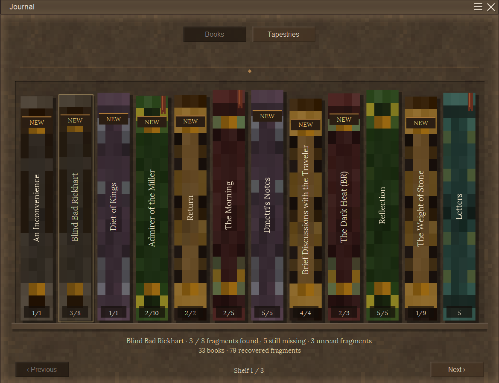

# BetterJournal

**Give your discoveries a home.**

BetterJournal replaces Vintage Story's journal list with a bookshelf of collected stories and a separate tapestry gallery. Open a book, turn its pages, and pick up where you left off.

By **NiclAss** · **Client-side only** · **Vintage Story 1.22.7** · **MIT**

The first public version, **v0.1.0**, is prepared and awaiting final in-game testing. It has not been published yet.

## Features

- **A bookshelf for your stories.** Collected journal entries become textured books with readable spines. Fragment counts show how much of a story you have recovered when its total is known.
- **Books that feel like books.** Animated covers and page turns, portrait pages, adjustable text size, and no scrolling through long entries. Turn pages with buttons, arrow keys or a horizontal swipe.
- **Find your place again.** NEW markers highlight unread recovered fragments. Reading positions and bookmarks help you return to unfinished stories, and Next unread takes you straight to unread text.
- **A tapestry collection.** Browse artwork and recovered lore in their own gallery. Intact pieces you have seen fill in the picture; missing pieces remain hidden. Rotten pieces do not add progress.
- **Vanilla and modded lore.** Supports entries delivered through the game's normal journal, including lore from mods such as BetterRuins. No server installation is needed.
- **A familiar look.** Uses the game's installed book materials, paper, shaded windows and buttons, with animated transitions between views.

## A closer look

### Read your collected stories

Long fragments flow across fitted, numbered pages. Change the text size without moving the surrounding artwork and controls.

### Build your tapestry collection

The gallery remembers individual intact pieces and keeps tapestry lore separate from the bookshelf. Completed discoveries can show the same NEW marker as books.

### Explore the lore behind the artwork

Open a tapestry to see its discovered image beside the journal lore you have recovered. Longer notes are divided into reading pages.

Screenshots show an in-game collection and include modded lore. BetterJournal does not grant the completed collection shown here; it displays your own discoveries. Some screenshots precede the final tapestry-name correction.

## Installation

1. Download `betterjournal-0.1.0.zip` from [GitHub Releases](https://github.com/NicIAss/BetterJournal/releases) once published.
2. Put the ZIP in your Vintage Story profile's `Mods` folder. Keep it zipped.
3. Start **Vintage Story 1.22.7**, enter a world or server, and press **J**, or your remapped journal key.

Install it on your **client only**. The server does not need BetterJournal. Remove older versions before updating. If you used a **Lore Bookshelf development build**, remove that ZIP too; do not load both journal replacements together. Its progress imports automatically.

## Controls

| Action | Control |
| --- | --- |
| Open or close the journal | J, or your existing journal binding |
| Switch collection | Books / Tapestries buttons |
| Open an entry | Click a book spine or tapestry |
| Turn pages / browse collection | Previous / Next or left/right arrows |
| Swipe a book page | Drag horizontally across the paper |
| Change reading text size | A- / A+ |
| Find unread book text | Next unread |
| Return to the collection | Back or Escape |
| Close from the collection | Escape, J or the close button |

## Progress and compatibility

BetterJournal keeps the game's normal journal discoveries and networking. It adds no stories and reveals only received lore. Unfamiliar mod chapters remain readable in books; independent lore databases or other journal replacements may need an adapter.

Reading history, bookmarks and tapestry memories are saved locally in `ModData/betterjournal/`, separately for each world and player. Uninstalling the mod does not remove vanilla discoveries. Progress does not automatically transfer to another computer. See [saved progress and migration](docs/PROGRESS.md) for details.

**NEW** tracks text that has been displayed, not whether you actually read it. Existing journal entries initially appear unread. A started story with missing fragments can keep its bookmark after you have read everything currently available. Entries without a reliable catalogue total show an unknown total.

The release targets **1.22.7**. Other game versions are not yet validated. First-time fitting of long entries can still cause a brief hitch; fitted layouts and animation textures are reused to reduce repeated work.

## Feedback and development

Found a problem? [Open an issue](https://github.com/NicIAss/BetterJournal/issues) with your game/mod versions, reproduction steps, relevant mods and screenshots.

- [Build from source](docs/DEVELOPING.md)
- [Validation status](VALIDATION.md)
- [Changelog](CHANGELOG.md)
- [Release notes](docs/releases/v0.1.0.md)

Original code is licensed under [MIT](LICENSE). Game content shown in screenshots belongs to its respective creators; see [third-party notices](THIRD_PARTY_NOTICES.md).
