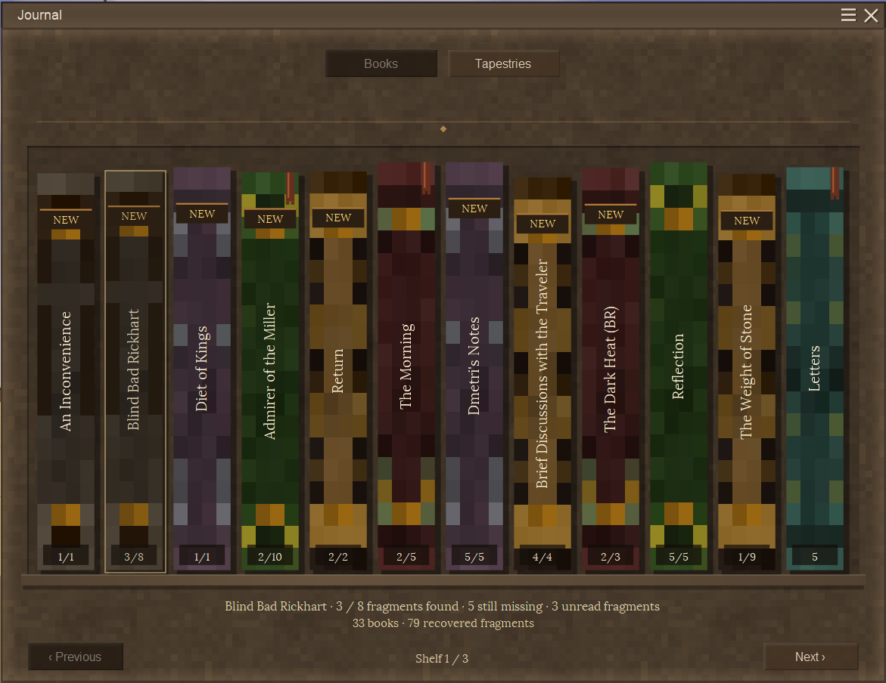
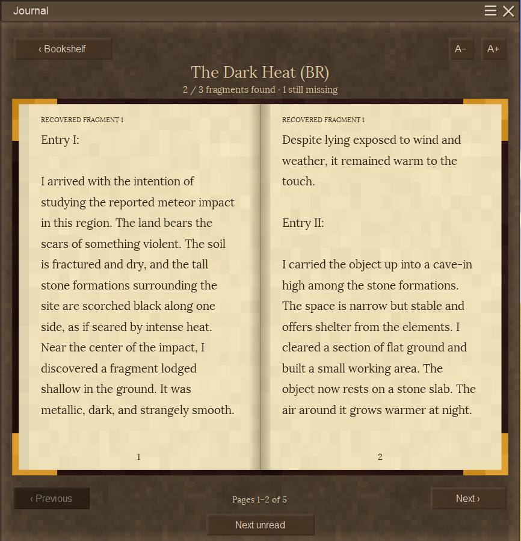
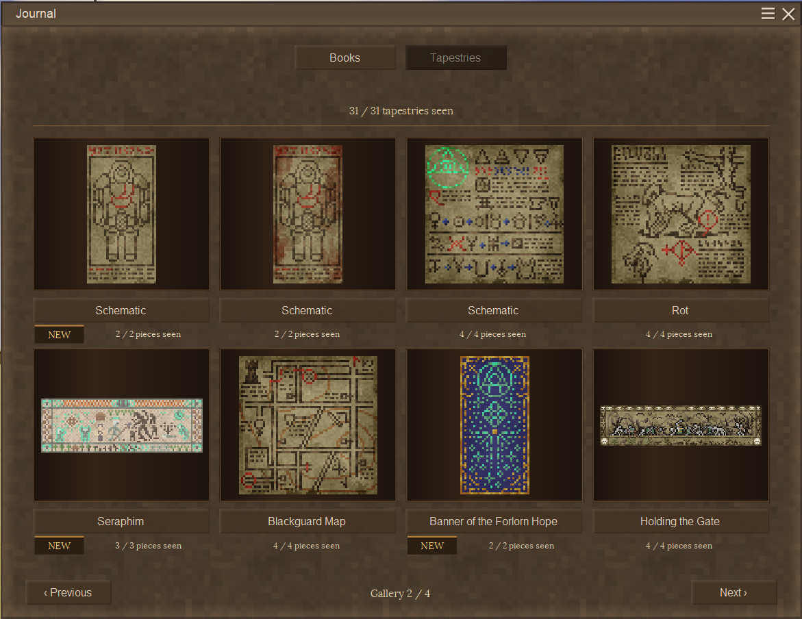
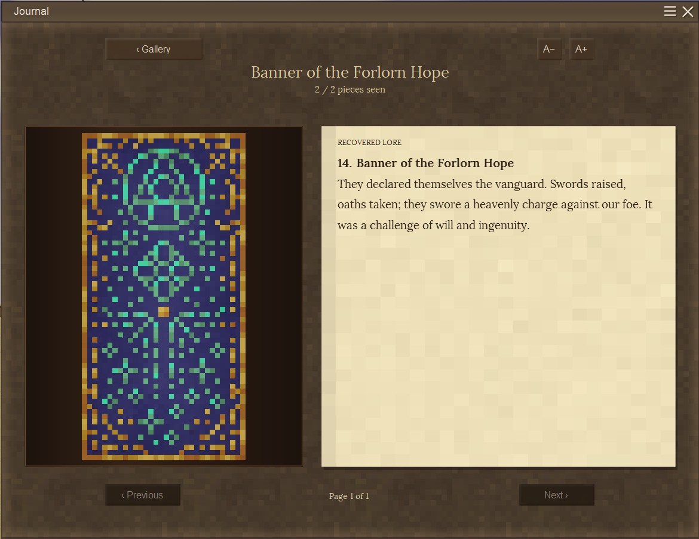

# BetterJournal

BetterJournal replaces Vintage Story's journal list with a bookshelf, animated books and a separate tapestry gallery. It displays the vanilla and modded lore your player has recovered through the normal journal.

By **NiclAss** · **Client-side only** · **Vintage Story 1.22.7** · **MIT**

Version **0.1.1** is available on the [Vintage Story Mod DB](https://mods.vintagestory.at/betterjournal).

## Features

- Collected journal entries become books with readable spines and found/total fragment counts from the lore catalogue, such as `5/8` for five Letters fragments.
- Books have animated covers and page turns. Long entries use fitted pages instead of scrolling, with adjustable text size.
- Turn pages with buttons, arrow keys or a horizontal swipe.
- NEW markers, bookmarks, saved reading positions and Next unread help you return to unfinished stories.
- The tapestry gallery remembers intact pieces you look at and displays recovered lore beside the artwork. Unseen pieces stay hidden; looking at rotten pieces adds no new progress.
- Supports vanilla lore and modded entries delivered through the normal journal, including BetterRuins. Install it on your client; the server does not need the mod.
- Uses the game's installed book textures, paper, window backgrounds and buttons.

## Screenshots

These screenshots show an existing collection, including modded lore. Your collection depends on your own discoveries.

## Installation

1. Download `BetterJournalv0.1.1.zip` from the [Vintage Story Mod DB](https://mods.vintagestory.at/betterjournal).
2. Put the ZIP in your Vintage Story profile's `Mods` folder. Keep it zipped.
3. Start **Vintage Story 1.22.7**, enter your world or server, and press **J**, or your remapped journal key.

You can install it in an existing singleplayer or multiplayer world. No new world or unexplored chunks are required.

## Progress and compatibility

| Situation | What happens |
| --- | --- |
| You install it after recovering some book fragments | Those fragments are available immediately. Missing story fragments remain missing. Without saved BetterJournal history, existing entries initially show NEW because vanilla does not supply prior reading history. |
| You already have tapestry lore in the vanilla journal | The matching standard tapestry is shown as complete with that received lore. Alternate artwork sharing the same lore still needs to be looked at separately. |
| You only looked at part of a tapestry before installation | Vanilla has no individual-piece viewing history for BetterJournal to import. Look at those intact pieces again to record them. This also applies to designs with no journal lore. |
| You find pieces while BetterJournal is installed | Each intact piece you look at is remembered for that world/player. Pieces can come from different copies of a design. Completing the remembered picture does not itself grant lore; the normal discovery rules still apply. |
| You look at rotten pieces | The observer ignores them. Previously recorded pieces or already received lore are retained; history is not revoked if cloth later rots or disappears. |
| You remove the mod | The vanilla journal returns on the next game start. Normal lore discoveries, existing tapestries, world blocks and items are unchanged. BetterJournal's local history files remain. |
| You reinstall in the same profile | Unchanged reading history and recorded pieces return if the local files remain. Lore received through the normal journal while the mod was absent appears too; new content starts unread. Partial pieces only looked at during that absence are not tracked. |
| You delete BetterJournal's local data | Bookmarks, viewing history and extra piece memories reset. Vanilla lore remains and can still restore matching standard tapestry artwork. |

The normal game grants tapestry lore when you look at a complete, intact assembly. Remembering pieces in the gallery does not unlock its story. A complete gallery image can therefore have no recovered lore yet. Designs with no assigned lore remain artwork only.

NEW records text that has been displayed, not whether you actually read it. A started story can keep its bookmark while fragments are missing or its total is unknown. Moving to a different computer/profile does not automatically move this history.

Vanilla and modded catalogue entries show `found/total` even when received chapter numbers repeat or change. A mod that inserts journal content without a complete catalogue can still have an unknown total; those entries show `found/?` rather than pretending the currently received fragments are the whole story.

Progress lives in `ModData/betterjournal/` under the active game profile, separately for each world and player. The mod writes no lore progress into the server journal. See [progress and storage](docs/PROGRESS.md) for the exact storage and compatibility behavior.

Other journal replacements can compete for the same shortcut. Independent lore systems and custom tapestry renderers may need an adapter. Removing a lore mod may leave saved journal records whose text or artwork needs that mod's assets. BetterJournal displays what the normal journal still contains; it does not supply missing mod assets. Changed text, translations or identities can appear unread again.

The supported target is **1.22.7**. Other game versions are not validated. First-time fitting of long entries or a new text size can still cause a brief hitch.

## Controls

| Action | Control |
| --- | --- |
| Open or close the journal | J, or your existing journal binding |
| Switch collection | Books / Tapestries |
| Open an entry | Click a book spine or tapestry |
| Turn pages / browse collection | Previous / Next or left/right arrows |
| Swipe a book page | Drag horizontally across the paper |
| Change reading text size | A- / A+ |
| Find unread book text | Next unread |
| Return to the collection | Back or Escape |
| Close from the collection | Escape, J or the close button |

## Development

[Report an issue](https://github.com/NicIAss/BetterJournal/issues) with your game/mod versions, reproduction steps, relevant mods and screenshots.

- [Build from source](docs/DEVELOPING.md)
- [Validation status](VALIDATION.md)
- [Changelog](CHANGELOG.md)
- [Release notes](docs/releases/v0.1.1.md)
- [ModDB description source](docs/moddb/description.html)

Original code is licensed under [MIT](LICENSE). Game content shown in screenshots belongs to its respective creators; see [third-party notices](THIRD_PARTY_NOTICES.md).
